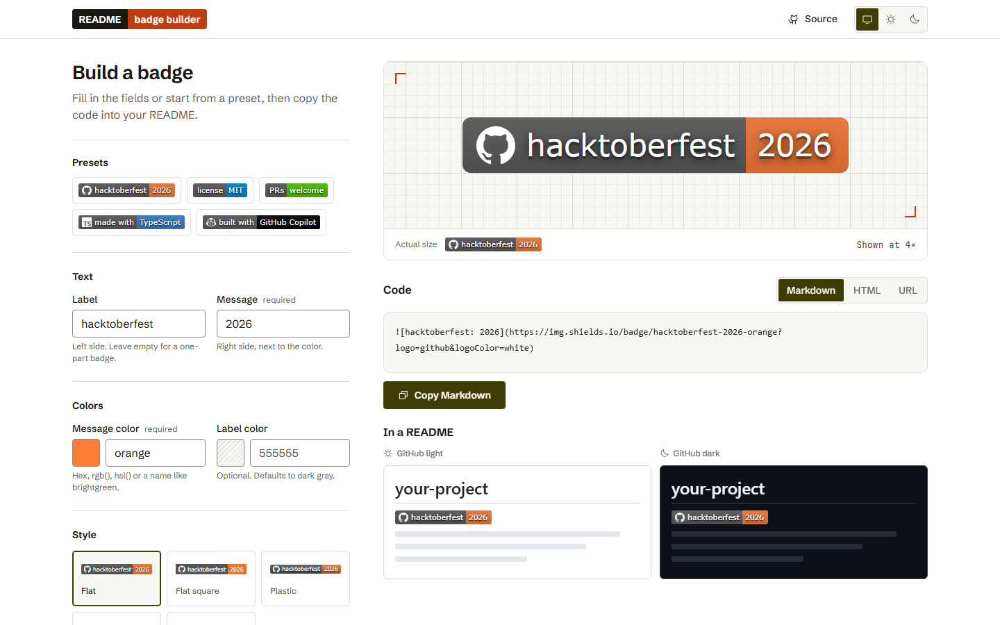
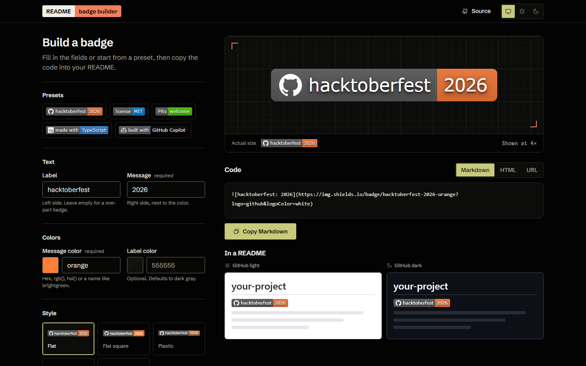

# README Badge Builder

[](LICENSE)


Build [shields.io](https://shields.io) badges for your README with a live preview. See how they look on GitHub's light and dark themes, then copy the Markdown, HTML or URL in one click.

(The badges above were made with this tool.)

| Light | Dark |
| --- | --- |
|  |  |

## Features

- **Live preview** at 4x on a grid, plus actual size, so you can check the details.
- **GitHub light and dark mockups**, so you see the badge in context before you copy it.
- **Markdown, HTML or URL output** with one-click copy. If the browser blocks clipboard access, it selects the text for you to copy.
- **Correct escaping** of shields.io's special characters. Dashes, underscores, spaces, `%`, `/`, `#` and Unicode come out exactly as typed.
- **Five styles**, each previewed with your own badge: flat, flat-square, plastic, for-the-badge and social.
- **Logos** from [Simple Icons](https://simpleicons.org), with optional label, logo and message colors.
- **Optional link**, for example to `LICENSE` or a full `https://` URL. Other schemes like `javascript:` are rejected.
- **Presets** for common badges: license, PRs welcome, made with TypeScript, built with GitHub Copilot.
- **Accessible**:
  - labels above every input, with errors announced next to the field
  - full keyboard support and visible focus rings
  - WCAG AA contrast in both themes
  - respects `prefers-reduced-motion`
- **Light, dark or system theme**, remembered between visits.

## Getting started

You need [Node.js](https://nodejs.org) 22.12 or newer.

```bash
git clone https://github.com/rahultapase/readme-badge-builder.git
cd readme-badge-builder
npm install
npm run dev
```

Then open the URL Vite prints (usually http://localhost:5173).

| Script | What it does |
| --- | --- |
| `npm run dev` | Start the dev server |
| `npm test` | Run the unit tests (Vitest) |
| `npm run build` | Type-check and build to `dist/` |
| `npm run preview` | Serve the production build locally |

> [!NOTE]
> There's no backend and no API key. Badge images come straight from `img.shields.io`, so the preview needs an internet connection. The generated code still works offline.

## How it works

The app turns form fields into a shields.io [static badge](https://shields.io/badges/static-badge) URL:

```
https://img.shields.io/badge/<label>-<message>-<color>?style=…&logo=…&logoColor=…&labelColor=…
```

Because `-` separates the parts, the text is escaped first. `-` becomes `--`, `_` becomes `__`, and a space becomes `_`. Then everything is percent-encoded. That logic lives in [`src/badge.ts`](src/badge.ts) and [`src/colors.ts`](src/colors.ts), and both are covered by unit tests.

```
src/
├── badge.ts        # URL and snippet builders (pure, tested)
├── colors.ts       # color validation and shields.io named colors (pure, tested)
├── main.ts         # form wiring, live preview, copy
├── presets.ts      # preset badges
├── theme.ts        # light / dark / system toggle
└── styles/         # OKLCH design tokens, base, layout, components
```

Built with plain TypeScript and CSS: no UI framework, self-hosted fonts (Schibsted Grotesk and Martian Mono), and [Phosphor](https://phosphoricons.com) icons.

## About this project

Built for the **Use GitHub Copilot to Build a Simple Application** challenge at [MLH Global Hack Week: Hacktoberfest](https://www.mlh.com/events/global-hack-week-open-source-90/challenges). The initial version was built with [Kiro](https://kiro.dev), an AI IDE.

Not affiliated with shields.io or GitHub.
